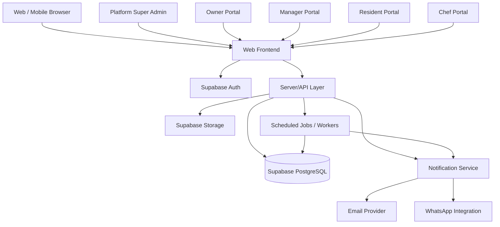

# ZIPCO Solutions PG SaaS — System Architecture

**Product:** PG & Hostel Management SaaS  
**Product working name:** Zipnary (confirm final branding before release)  
**Document:** Architecture Specification  
**Version:** 1.0  
**Status:** Proposed architecture for technical review  
**Primary deployment context:** India; INR as default currency

---

## 1. Architecture Goals

The platform must support multiple independent PG/hostel businesses from one SaaS application while ensuring that each customer's records remain isolated.

The architecture must support:
- Platform-level administration by ZIPCO Solutions.
- Owner onboarding and approval before full PG management access.
- Multiple approved buildings per customer.
- Floor, room, bed, resident, admission, and checkout management.
- Resident payments, expenses, finance, complaints, maintenance, communication, staff attendance, end-of-day reports, kitchen operations, and inventory.
- Four customer portals: Owner, Manager, Resident, Chef.
- A separate Platform Super Admin interface.
- Configurable subscription and account limits.
- Secure authentication, auditability, and future scaling without creating a separate application for each customer.

## 2. Recommended High-Level Architecture

Use **one application codebase, one Supabase project initially, and a shared PostgreSQL database with strict tenant isolation**. Separate portals should be route/layout boundaries and permission scopes—not separate databases or independent apps by default.



### Important implementation rule
- The frontend must never contain the Supabase service-role key or other server secrets.
- Use the Supabase publishable/anon key only in client contexts that are protected by RLS.
- Privileged actions (platform approvals, tenant suspension, account provisioning, permission changes, payment webhooks) must go through trusted server-side code or Supabase Edge Functions.
- Never trust a tenant ID or role supplied by the browser without validating it on the server/database.

## 3. Logical Layers

### 3.1 Presentation layer
One shared frontend with role-aware navigation and layouts:
- `/platform/*` — ZIPCO Solutions Platform Super Admin
- `/owner/*` — PG Owner
- `/manager/*` — PG Manager
- `/resident/*` — Resident
- `/chef/*` — Chef

These paths are an example. Route names can change, but authorization must not depend only on the route.

### 3.2 Authentication layer
Use Supabase Auth:
- Google sign-in for PG owners, as specified.
- Email/password or secure invitation/activation flow for residents, based on final product policy.
- Manager and chef accounts created/invited by an authorized owner or manager.
- Enforce verified email where required.
- Password reset and account recovery.
- Session expiry and revocation for suspended accounts.

Authentication proves who a user is. Authorization determines which tenant, building, and features that user may access.

### 3.3 Authorization layer
Use database-backed role and membership records, not a role string trusted from client storage.

Recommended concepts:
- `profiles`: user profile linked to `auth.users`.
- `tenants`: each PG business/customer.
- `tenant_memberships`: relationship between a user and a tenant, including role and status.
- `building_memberships`: optional access mapping for staff restricted to particular buildings.
- `platform_admins`: authorized ZIPCO Solutions platform administrators.

The platform Super Admin is not the same as a PG Owner. Platform administrators should be granted through a controlled internal process, protected with MFA where available, and audited.

### 3.4 Application/service layer
Use server-side services for operations that require validation or privileged access:
- Owner onboarding and approval.
- Building approval and activation.
- Resident account provisioning.
- Admission approval and checkout.
- Payment recording and reversals.
- Subscription status changes.
- Inventory transactions.
- Exports and privileged reports.
- Notifications and WhatsApp message preparation/sending.
- Data deletion/export requests.

### 3.5 Data layer
Supabase PostgreSQL stores structured business data. Supabase Storage stores private files such as resident documents, invoices, receipts, and maintenance photos. File access should be controlled with storage policies and/or short-lived signed URLs.

---

## 4. Multi-Tenant Data Model

### 4.1 Tenant hierarchy

```text
Platform
└── Tenant (one PG business/customer account)
    ├── Owner
    ├── Managers (up to configured limit)
    ├── Chefs (up to configured limit)
    ├── Buildings (one or many)
    │   ├── Floors
    │   │   └── Rooms
    │   │       └── Beds
    │   ├── Residents / Admissions
    │   ├── Payments / Expenses
    │   ├── Complaints / Maintenance
    │   ├── Inventory / Kitchen
    │   └── Communication / Reports
    └── Subscription
```

A tenant represents the customer business. A building is a property owned/managed by that tenant. All business records must be scoped to a tenant, and building-specific records should additionally reference the building.

### 4.2 Suggested domain tables

**Identity and tenancy**
- `profiles`
- `tenants`
- `tenant_memberships`
- `building_memberships`
- `platform_admins`
- `tenant_onboarding_requests`
- `tenant_building_requests`
- `audit_logs`

**Properties and occupancy**
- `buildings`
- `floors`
- `rooms`
- `beds`
- `residents`
- `admissions`
- `resident_documents`
- `resident_room_assignments`
- `checkouts`

**Billing and finance**
- `rent_charges`
- `payment_transactions`
- `payment_allocations`
- `receipts`
- `expenses`
- `expense_categories`
- `vendors`
- `expense_attachments`
- `subscriptions`
- `subscription_plans`
- `subscription_invoices`
- `subscription_payments`

**Operations**
- `complaints`
- `maintenance_requests`
- `maintenance_schedules`
- `maintenance_vendors` (or a shared vendor table with vendor categories)
- `staff_attendance`
- `staff_daily_reports`
- `staff_tasks`
- `notices`
- `announcements`
- `meal_menus`
- `meal_availability`
- `ingredient_items`
- `inventory_locations`
- `inventory_transactions`
- `recipes` (optional future feature)
- `meal_consumption_records`

**Platform**
- `notification_preferences`
- `notifications`
- `support_tickets`
- `feature_flags` (if needed)
- `platform_settings`

The exact schema should be normalized during database design. Do not create every table before validating its relationships and use cases.

---

## 5. Tenant Isolation and Database Security

### Mandatory rule
Every tenant-owned row must be accessible only to authenticated users with valid membership and permission for that tenant and, where applicable, building.

### Row-Level Security (RLS)
Enable RLS on all tenant-owned tables. Policies should verify:
1. The authenticated user has an active membership in the record's tenant.
2. The user's role permits the requested action.
3. The user has access to the specific building if building-scoped access applies.
4. The tenant or account is not suspended where that status should block the action.
5. The operation is allowed for the current record state.

Use database functions carefully to avoid recursive RLS policies and privilege escalation. Keep authorization logic centralized and tested.

### Tenant-safe relationships
- Use composite constraints where practical to prevent a record from referencing a building, room, resident, or expense from another tenant.
- Validate floor-to-building, room-to-floor, bed-to-room, and resident-to-assignment relationships.
- A room assignment must not allow two active residents to occupy the same bed simultaneously.
- Use transactions and uniqueness constraints for concurrent admissions.
- Never rely on hiding a building in the UI as the security mechanism.

### Platform Super Admin access
- Platform administrators have separate, explicit platform-level grants.
- Platform access must not be given merely because a user sets `role = 'super_admin'` in a client-side profile.
- Sensitive cross-tenant support access should be limited, justified, and logged.
- Restrict access to resident identity documents and other sensitive data to approved use cases.
- Apply MFA to platform administrators where available.

---

## 6. Onboarding and Approval Architecture

### PG owner onboarding
1. Owner signs in using Google.
2. Create or retrieve the authenticated user profile.
3. Show a restricted onboarding workspace, not the full operational dashboard.
4. Owner submits contact details, phone number, business details, building count, proposed building information, photos, floors, rooms, sharing types, and expected capacity as required.
5. Create an onboarding request with status `submitted`.
6. Platform Super Admin reviews the request.
7. Super Admin approves, rejects, or requests changes.
8. On approval, activate the tenant and approved building entitlements.
9. Notify the owner.
10. Owner completes detailed building/floor/room/bed setup.
11. Owner can request additional buildings later; these should follow the configured approval workflow.

### Recommended statuses
- `draft`
- `submitted`
- `under_review`
- `changes_requested`
- `approved`
- `rejected`
- `suspended`

Keep tenant approval and building approval as separate entities if the business rules require approving a customer and each building independently.

---

## 7. Resident Admission and Account Provisioning

### Admission flow
1. Owner or authorized manager opens Admissions.
2. Select an available building, floor, room, and bed.
3. Enter resident information and required documents.
4. Record rent, deposit, billing frequency, start date, and any initial payment.
5. Create an admission record in `pending_review` or the configured initial state.
6. Authorized user verifies details and approves the admission.
7. In a trusted server-side function, create/invite the resident's auth account or link an existing account.
8. Link the resident to the correct tenant and active room/bed assignment.
9. Send a secure activation/reset link through the configured channel.
10. Update occupancy only after the admission and bed assignment transaction succeeds.

### Credential security
- Never generate predictable passwords.
- Never store plaintext passwords in application tables.
- Prefer Supabase Auth invitation or secure password setup links.
- WhatsApp can open a prefilled message containing the portal URL and secure activation link. Do not put a plaintext password in a message.
- Confirm the resident phone number and consent/communication policy before sending messages.

---

## 8. Domain Workflows and Data Consistency

### 8.1 Buildings, rooms, beds
- A tenant can have multiple approved buildings.
- Each building has floors, each floor has rooms, and each room has beds/capacity.
- Sharing types and rent amounts are configurable by the owner.
- Vacancy is derived from active bed assignments, not manually maintained as a conflicting number.
- Room/bed edits must not invalidate active resident assignments.

### 8.2 Payments and rent
- Separate rent charges from payment transactions.
- Allocate payments to one or more charges.
- Maintain receipt records and immutable payment history.
- Cash/UPI/bank/card entries require the actor, date, amount, method, and optional reference.
- Corrections should use authorized reversals/adjustments rather than overwriting financial history.
- Dashboard totals must use consistent definitions for billed, collected, outstanding, and overdue amounts.

### 8.3 Expenses and maintenance
- Use a canonical expense ledger shared by general Expenses and Maintenance.
- Maintenance requests can link to complaints and expenses.
- Recording a repair cost must not create a duplicate expense.
- Track incurred amount, paid amount, and outstanding amount separately.
- Store bills and receipts in private object storage.

### 8.4 Inventory and kitchen
- Inventory is scoped to a specific tenant and building (or explicitly configured storage location within a building).
- Purchases, issues to kitchen, consumption, returns, and wastage are separate inventory transactions.
- Chef ingredient usage reduces the appropriate building stock through a validated transaction.
- Do not allow negative stock unless the owner has explicitly enabled an audited exception.
- Resident meal availability feeds expected meal counts. Define a deadline and late-change policy before implementation.
- Preserve historical stock movements; do not overwrite past transactions to correct balances.

### 8.5 Staff attendance and end-of-day reports
- An authorized manager marks daily staff attendance.
- Attendance records include staff, building, date, status, marked by, and timestamp.
- The manager records or confirms the staff member's end-of-day work summary.
- Reports are saved with author, timestamp, and optional attachments.
- Owner can review permitted records. Platform-level access is controlled and audited.

### 8.6 Communication and complaints
- Notices and menus are scoped to the tenant and, if necessary, one building.
- Residents see only communications intended for their tenant/building.
- Complaint records reference the resident and their relevant room/building at submission time.
- Complaint and maintenance statuses remain linked but distinct.

---

## 9. Subscription and Account Limits

Subscription rules must be configurable by the Platform Super Admin, not hard-coded into UI components.

Previously discussed business assumptions to confirm before implementation:
- Three-month free trial.
- A reference plan of ₹4,999/month for up to 120 residents.
- Price may vary based on resident capacity/count.
- One owner per customer.
- Up to three managers excluding the owner.
- Up to three chefs.
- Resident and staff limits are enforced server-side.

Treat these as provisional configuration values until the pricing policy is formally approved.

### Limit enforcement
- Store subscription start/end dates and status.
- Store the applicable resident and staff limits on the plan or subscription.
- Enforce limits during account creation/admission, not only in the UI.
- Prevent accidental removal of existing data when a limit is exceeded.
- Define trial-expiry, grace-period, read-only, suspension, and data-export policies before launch.

---

## 10. Suggested API / Service Boundaries

Prefer domain-oriented server functions or API services. Exact implementation may use Next.js server actions/routes, a dedicated backend, or Supabase Edge Functions, but privileged operations must execute server-side.

Suggested services:
- `onboardingService`
- `tenantAccessService`
- `buildingService`
- `admissionService`
- `residentAccountService`
- `paymentService`
- `expenseService`
- `maintenanceService`
- `inventoryService`
- `attendanceService`
- `communicationService`
- `subscriptionService`
- `notificationService`
- `reportingService`

Examples of privileged operations:
- `approveTenantOnboarding`
- `approveBuilding`
- `approveAdmission`
- `provisionResidentAccount`
- `recordPayment`
- `reversePayment`
- `postInventoryTransaction`
- `suspendTenant`
- `exportTenantReport`

These names describe service responsibilities, not pre-existing implemented endpoints.

---

## 11. File and Storage Architecture

Use private storage buckets for:
- Resident documents
- Resident profile images, where privacy rules require it
- Payment receipts
- Expense invoices
- Maintenance photographs
- Building photographs
- Signed agreements

Storage policy requirements:
- Use tenant-scoped object paths, for example `tenant_id/building_id/...`.
- Validate authorization against the record and user membership, not just the path.
- Avoid public buckets for identity documents, financial documents, and private resident files.
- Use short-lived signed URLs when temporary access is needed.
- Validate file type, size, and upload permissions.
- Keep a reference to each file in its owning record.

---

## 12. Real-Time Updates and Background Jobs

Use realtime subscriptions only where live updates materially improve the workflow:
- Occupancy/vacancy changes.
- Complaint status changes.
- New announcements.
- Meal availability counts.
- Inventory updates.
- Payment status updates where appropriate.

All realtime subscriptions must be tenant-scoped and permission-checked. Realtime delivery is not a substitute for database authorization.

Background jobs may handle:
- Rent reminders.
- Trial/subscription reminders.
- Maintenance reminders.
- Scheduled recurring maintenance creation.
- Report generation.
- Notification retries.

Background jobs must be idempotent and record success/failure state.

---

## 13. Observability and Audit

Record:
- Authentication and privileged access events.
- Tenant/building approval decisions.
- Account suspensions and reinstatements.
- Role and permission changes.
- Payment creation and reversal.
- Expense changes.
- Inventory transactions.
- Admission and checkout changes.
- Exports of sensitive data.

Do not log passwords, session tokens, private activation tokens, or unnecessary sensitive document contents.

Monitor:
- API errors and latency.
- Failed background jobs.
- Realtime connection failures.
- Payment/webhook processing errors.
- Unauthorized access attempts.
- Database capacity and query performance.

---

## 14. Deployment and Environments

Recommended environments:
- **Development:** synthetic/test data and rapid iteration.
- **Staging:** production-like configuration for end-to-end and authorization testing.
- **Production:** real customer data, strict access, backups, monitoring, and controlled releases.

Use separate Supabase projects for development/staging and production when feasible. This is different from creating a separate database for every customer: all customers can share the production project while tenant isolation is enforced through RLS and server-side authorization.

Deployment pipeline:
1. Review code.
2. Run linting, type checks, and unit tests.
3. Apply database migrations to a test environment.
4. Run integration and RLS tests.
5. Deploy to staging.
6. Verify key workflows.
7. Deploy to production with a rollback plan.

Never run destructive migrations directly on production without backup and review.

---

## 15. Testing Strategy

### Unit tests
- Rent and outstanding balance calculations.
- Payment allocation and reversal logic.
- Inventory quantity calculations.
- Subscription and limit validation.
- Status transition rules.

### Integration tests
- Owner onboarding and approval.
- Building approval and setup.
- Resident admission and account activation.
- Payment recording and receipt generation.
- Expense and maintenance integration.
- Chef ingredient usage and stock reconciliation.
- Staff attendance and end-of-day reports.

### Security tests
- Tenant A cannot read or modify Tenant B records.
- Manager cannot access unassigned buildings.
- Resident can access only their own permitted records.
- Chef cannot access finance or resident records beyond their role.
- Platform admin grants cannot be self-assigned by customers.
- Private files and exports obey authorization rules.

### End-to-end tests
- Signup → approval → building setup → admission → resident login.
- Payment → receipt → resident history → dashboard totals.
- Complaint → maintenance request → expense → finance report.
- Purchase → ingredient issue/usage → closing stock.
- Manager attendance → end-of-day report → owner review.

---

## 16. Recommended Implementation Order

1. Confirm current repository, framework, Supabase project, and deployment setup.
2. Establish environments, migrations, authentication, profiles, tenants, memberships, and RLS.
3. Implement platform Super Admin onboarding and approval.
4. Implement building/floor/room/bed structure.
5. Implement admissions and secure resident account provisioning.
6. Implement resident portal and role-aware navigation.
7. Implement rent charges, payments, receipts, and reconciliation.
8. Implement complaints and maintenance.
9. Implement expenses and finance summaries.
10. Implement inventory and Chef workflows.
11. Implement staff attendance and end-of-day reports.
12. Implement communication, notices, meal availability, and notifications.
13. Implement reports, exports, audit logs, and platform settings.
14. Run full security, concurrency, reconciliation, and responsive UI testing.

Do not start by building all dashboard screens against placeholder data. Establish tenant identity, relationships, authorization, and transactional rules first so the screens use a reliable foundation.

---

## 17. Architecture Decisions to Confirm

Before locking the technical implementation, confirm:
1. The existing frontend framework and repository structure.
2. Whether the application will use Next.js with Supabase directly or a separate API/backend.
3. Whether residents authenticate with email/password, email OTP, or another secure activation flow.
4. Whether buildings require separate approval after the tenant has been approved.
5. Exact trial expiry and unpaid-subscription behavior.
6. Whether managers may record payments, approve expenses, or only submit them for owner approval.
7. Whether inventory belongs to each building or to multiple stock locations within a building.
8. Which WhatsApp/email provider will send messages and what consent policy applies.
9. Whether multi-currency or multiple countries are in scope.

---

## 18. Final Architecture Principle

Use one shared SaaS platform with clearly separated domains, explicit roles, tenant-scoped records, strict database policies, and auditable privileged actions. Keep customer data isolated by design. Make business workflows transactional where money, occupancy, or inventory is involved.

This architecture is a proposed blueprint. It should be reconciled with the actual existing codebase and Supabase configuration before migrations or production changes are made.
