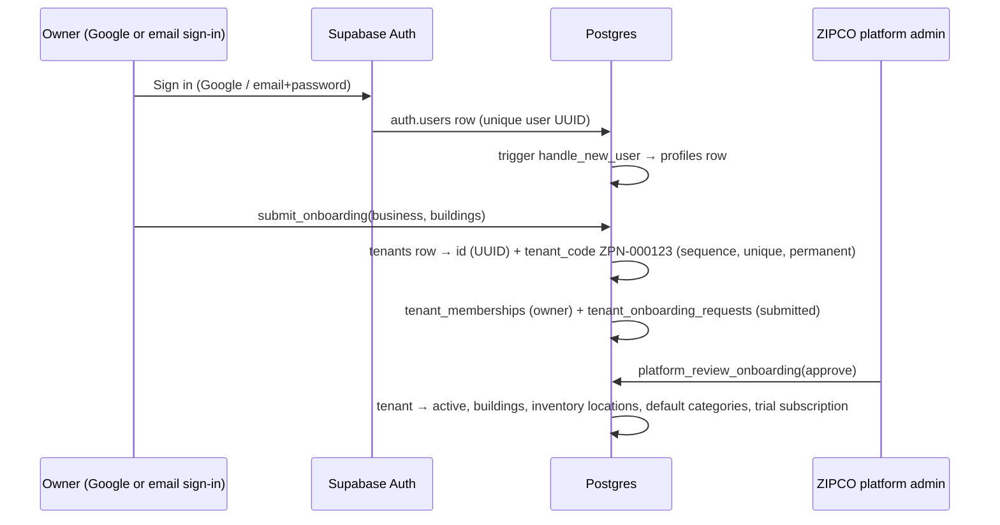

# Zipnary — Database Structure

**Source of truth:** `supabase/migrations/` (15 migrations). This document describes the schema as it exists after
`npm run db:reset`; the table reference at the end is generated from the live local database.
Generated TypeScript types: `src/lib/database.types.ts` (`npm run db:types`).

- **One Postgres database, shared by every hostel business (tenant)**, with strict isolation: every business row carries
  `tenant_id`, building-level rows also carry `building_id`, and Row-Level Security (RLS) is enabled on **all 56 tables**.
- **All five portals use the same database** through the same rules. A portal is only a screen; what a user can read or
  change is decided in the database by their role and membership.
- **Data is not shared between hostels.** One hostel's residents, payments, stock, chats, files, etc. are invisible to
  every other hostel. This is enforced by RLS and composite foreign keys, and checked by `npm run test:rls` (49 tests).

---

## 1. How a hostel gets its unique ID



| ID | Where | Format | Assigned by | Purpose |
|---|---|---|---|---|
| User ID | `auth.users.id` = `profiles.id` | UUID | Supabase Auth at first sign-in (Google or email) | Identity of a person |
| **Tenant ID** | `tenants.id` | UUID | Database, when onboarding is submitted | Key every business table references (`tenant_id`) |
| **Tenant code** | `tenants.tenant_code` | `ZPN-000001` | Database sequence `tenant_code_seq` (migration 14) | Human-readable business ID shown on screens; unique, cannot be changed (trigger) |
| Building ID | `buildings.id` | UUID | Database on approval / building request | Key for building-scoped rows (`building_id`) |
| Receipt number | `receipts.receipt_number` | `RCPT-2026-00001` | `receipt_counters`, per tenant per year | Sequential receipts per hostel |

The client never supplies `tenant_id`, `building_id`, roles or codes for privileged actions: security-definer functions
derive them from `auth.uid()` and membership rows.

> **Google sign-in:** the app already calls Supabase's Google provider (`Continue with Google`). It works once a Google
> OAuth client ID/secret is configured — in `supabase/config.toml` under `[auth.external.google]` for local, or in the
> Supabase dashboard for hosted projects. Those credentials must come from your Google Cloud account; none are stored in
> this repo. A Google user goes through exactly the same flow above and gets the same unique IDs.

---

## 2. Isolation model (why data never mixes between hostels)

```text
Platform (ZIPCO)                 platform_admins, subscription_plans, profiles
└── Tenant (one hostel business) tenants  ← tenant_id, tenant_code
    ├── memberships              tenant_memberships (owner / manager / chef / resident)
    ├── subscription             subscriptions (limits, trial)
    ├── tenant-wide settings     expense_categories, maintenance_categories, vendors, inventory_items, meal_settings
    └── Building                 buildings  ← building_id (managers/chefs: building_memberships)
        ├── floors → rooms → beds
        ├── residents, admissions, resident_room_assignments, checkouts, resident_documents
        ├── rent_charges, payment_transactions, payment_allocations, receipts
        ├── expenses, expense_payments, expense_attachments
        ├── complaints, maintenance_requests, maintenance_activity, maintenance_attachments
        ├── meal_menus, meal_availability, meal_reviews, kitchen_daily_reports
        ├── inventory_locations (store, kitchen), inventory_transactions (ledger)
        ├── staff_members, staff_attendance, staff_daily_reports
        ├── notices, notice_reads, chat_channels, chat_messages, chat_channel_reads, notifications
        └── community_posts, polls, poll_options, poll_votes, visitor_passes   (migration 15)
```

Enforcement layers:

1. **RLS on every table.** Policies call helper functions that only answer about the signed-in user:
   `is_platform_admin()`, `has_tenant_role(tenant, roles)` (also requires the tenant to be `active`),
   `can_access_building(building)` (owners: all buildings; managers/chefs: assigned only), `my_resident_ids()`.
2. **Composite foreign keys** `(tenant_id, building_id, …)` so a row can never point at another hostel's building, room,
   bed or resident (migrations 2, 3, 12).
3. **Writes through RPCs only.** `authenticated` has `SELECT` plus a few narrow column `UPDATE/INSERT` grants
   (migration 10); every multi-row or money/stock change is a security-definer function that re-checks role and scope.
4. **Private storage** buckets authorize by the owning record, not by path (migration 13).
5. **Suspension:** a tenant whose status is not `active` loses all operational access immediately.

---

## 3. What each portal reads and writes

| Portal (port) | Who | Reads (RLS-limited) | Writes (RPC) |
|---|---|---|---|
| Platform admin (1000) | `platform_admins` | all tenants, onboarding requests, building requests, plans, audit logs | `platform_review_onboarding`, `platform_review_building`, `platform_set_tenant_status`, `platform_update_subscription`, `platform_upsert_plan` |
| Owner (2001) | owner membership | everything of **their** tenant | all owner workflows: admissions approval, payments + reversal, expenses, staff, salaries, invites, settings |
| Manager (3000) | manager membership + `building_memberships` | their tenant, **assigned buildings only** | admissions (create), payments, expenses, maintenance, attendance, notices — no approvals, invites or reversals |
| Kitchen (4000) | chef membership + `building_memberships` | menus, meal counts, stock of assigned buildings — **no** KYC, payments or salaries | `upsert_meal_menu`, `inventory_move`, `submit_kitchen_report` |
| Resident (5000) | resident membership | **own** charges, payments, complaints, meal responses, visitor passes, suggestions/feedback, poll votes; their building's notices, menus, chats, polls, lost & found and marketplace posts; opted-in birthdays (first name + day only) | `set_meal_availability`, `submit_meal_review`, `create_complaint`, `send_chat_message`, `mark_notice_read`, `create_community_post`, `vote_poll`, `request_visitor_pass`, `cancel_visitor_pass`, `mark_channel_read`, `set_share_birthday` |

---

## 4. Views (derived, never edited)

| View | Derived from | Used for |
|---|---|---|
| `rent_charge_balances` | `rent_charges` − confirmed `payment_allocations` | dues, outstanding, overdue |
| `expense_balances` | `expenses` − `expense_payments` | paid / outstanding per expense |
| `inventory_balances`, `inventory_stock` | sum of `inventory_transactions` per location | store / kitchen stock (never negative) |
| `resident_directory` | residents + active assignment + balances | resident lists, pickers, reports |

## 5. Integrity rules worth knowing

- One active resident per bed and one active bed per resident (partial unique indexes on `resident_room_assignments`).
- Money is `numeric`; payments and stock movements are append-only and corrected by reversals/adjustments.
- Payment, admission, expense and inventory RPCs are idempotent (`idempotency_keys`), so retries record once.
- Every privileged action writes `audit_logs`.
- Timestamps are `timestamptz`; business dates use the tenant's `timezone` (default `Asia/Kolkata`).

## 5b. Resident community (migration 15)

| Table | Who sees it | Written by |
|---|---|---|
| `community_posts` | Lost & Found / Marketplace: residents of the same building. Suggestions / Feedback: the author + the building's owner/manager. Stores the author's first name (`author_name`) so residents never read other residents' records. | `create_community_post` (resident), `respond_community_post` (author closes; staff reply/close) |
| `polls`, `poll_options` | Staff of the building/tenant; residents of the building (or every building when `building_id` is null) | `create_poll`, `close_poll` (owner/manager) |
| `poll_votes` | A resident sees only their own vote; totals via `poll_summaries()` | `vote_poll` — one row per resident per poll (primary key); re-voting replaces it |
| `visitor_passes` | The requesting resident + the building's owner/manager | `request_visitor_pass` / `cancel_visitor_pass` (resident); `update_visitor_pass` approve → 6-character gate code, reject, check in/out (staff, audited) |
| `chat_channel_reads` | Own rows only | `mark_channel_read`; `my_chat_overview()` returns readable chats with last message and unread count |
| `residents.share_birthday` | — | `set_share_birthday`; `building_birthdays()` lists only opted-in residents of the caller's building: first name, room and day (never the year) |

## 6. Not in the schema yet (planned, see `docs/architecture-review.md`)

`subscription_invoices`, `subscription_payments`, `maintenance_schedules`, `support_tickets`, `platform_settings`,
`notification_preferences`, an outbox for email/WhatsApp delivery, and background jobs (e.g. trial expiry).

---

## 7. Table reference (generated from the local database)

`→` marks a foreign key to another `public` table. Columns referencing `auth.users` (e.g. `owner_user_id`,
`created_by`) are not marked.

### 1. Platform & identity

#### `profiles`

| Column | Type | Null | Default / references |
|---|---|---|---|
| id | uuid |  |  |
| full_name | text | yes |  |
| phone | text | yes |  |
| email | text | yes |  |
| avatar_path | text | yes |  |
| created_at | timestamp with time zone |  | `now()` |
| updated_at | timestamp with time zone |  | `now()` |

#### `platform_admins`

| Column | Type | Null | Default / references |
|---|---|---|---|
| user_id | uuid |  |  |
| status | text |  | `'active'::text` |
| created_by | uuid | yes |  |
| created_at | timestamp with time zone |  | `now()` |

#### `subscription_plans`

| Column | Type | Null | Default / references |
|---|---|---|---|
| id | uuid |  | `gen_random_uuid()` |
| name | text |  |  |
| monthly_price | numeric |  |  |
| included_residents | integer |  |  |
| max_managers | integer |  |  |
| max_chefs | integer |  |  |
| trial_days | integer |  | `90` |
| is_default | boolean |  | `false` |
| is_active | boolean |  | `true` |
| created_at | timestamp with time zone |  | `now()` |
| updated_at | timestamp with time zone |  | `now()` |

#### `tenants`

| Column | Type | Null | Default / references |
|---|---|---|---|
| id | uuid |  | `gen_random_uuid()` |
| business_name | text |  |  |
| owner_user_id | uuid |  |  |
| phone | text | yes |  |
| email | text | yes |  |
| city | text | yes |  |
| status | text |  | `'pending'::text` |
| approved_at | timestamp with time zone | yes |  |
| approved_by | uuid | yes |  |
| timezone | text |  | `'Asia/Kolkata'::text` |
| currency | text |  | `'INR'::text` |
| created_at | timestamp with time zone |  | `now()` |
| updated_at | timestamp with time zone |  | `now()` |
| tenant_code | text |  | `('ZPN-'::text ` |

#### `subscriptions`

| Column | Type | Null | Default / references |
|---|---|---|---|
| id | uuid |  | `gen_random_uuid()` |
| tenant_id | uuid |  | → `tenants` |
| plan_id | uuid |  | → `subscription_plans` |
| status | text |  | `'trialing'::text` |
| trial_start | timestamp with time zone | yes |  |
| trial_end | timestamp with time zone | yes |  |
| current_period_start | timestamp with time zone | yes |  |
| current_period_end | timestamp with time zone | yes |  |
| resident_limit | integer |  |  |
| manager_limit | integer |  |  |
| chef_limit | integer |  |  |
| price_override | numeric | yes |  |
| created_at | timestamp with time zone |  | `now()` |
| updated_at | timestamp with time zone |  | `now()` |

#### `tenant_onboarding_requests`

| Column | Type | Null | Default / references |
|---|---|---|---|
| id | uuid |  | `gen_random_uuid()` |
| tenant_id | uuid |  | → `tenants` |
| submitted_by | uuid |  |  |
| status | text |  | `'submitted'::text` |
| contact_details | jsonb |  | `'{}'::jsonb` |
| business_details | jsonb |  | `'{}'::jsonb` |
| review_notes | text | yes |  |
| reviewed_by | uuid | yes |  |
| reviewed_at | timestamp with time zone | yes |  |
| created_at | timestamp with time zone |  | `now()` |
| updated_at | timestamp with time zone |  | `now()` |

#### `tenant_memberships`

| Column | Type | Null | Default / references |
|---|---|---|---|
| id | uuid |  | `gen_random_uuid()` |
| tenant_id | uuid |  | → `tenants` |
| user_id | uuid | yes |  |
| invite_email | text | yes |  |
| display_name | text | yes |  |
| role | text |  |  |
| status | text |  | `'invited'::text` |
| invited_by | uuid | yes |  |
| joined_at | timestamp with time zone | yes |  |
| created_at | timestamp with time zone |  | `now()` |

#### `audit_logs`

| Column | Type | Null | Default / references |
|---|---|---|---|
| id | uuid |  | `gen_random_uuid()` |
| tenant_id | uuid | yes | → `tenants` |
| actor_user_id | uuid | yes |  |
| actor_type | text |  |  |
| action | text |  |  |
| entity_type | text |  |  |
| entity_id | uuid | yes |  |
| before_data | jsonb | yes |  |
| after_data | jsonb | yes |  |
| created_at | timestamp with time zone |  | `now()` |

#### `idempotency_keys`

| Column | Type | Null | Default / references |
|---|---|---|---|
| tenant_id | uuid |  | → `tenants` |
| operation | text |  |  |
| key | text |  |  |
| result | jsonb | yes |  |
| created_by | uuid | yes |  |
| created_at | timestamp with time zone |  | `now()` |

### 2. Property (per building)

#### `buildings`

| Column | Type | Null | Default / references |
|---|---|---|---|
| id | uuid |  | `gen_random_uuid()` |
| tenant_id | uuid |  | → `tenants` |
| name | text |  |  |
| code | text | yes |  |
| address | text | yes |  |
| city | text | yes |  |
| status | text |  | `'pending_approval'::text` |
| requested_details | jsonb |  | `'{}'::jsonb` |
| review_notes | text | yes |  |
| approved_by | uuid | yes |  |
| approved_at | timestamp with time zone | yes |  |
| created_by | uuid | yes |  |
| created_at | timestamp with time zone |  | `now()` |
| updated_at | timestamp with time zone |  | `now()` |

#### `building_memberships`

| Column | Type | Null | Default / references |
|---|---|---|---|
| id | uuid |  | `gen_random_uuid()` |
| tenant_id | uuid |  | → `buildings`, `tenants` |
| building_id | uuid |  | → `buildings` |
| membership_id | uuid |  | → `tenant_memberships` |
| created_at | timestamp with time zone |  | `now()` |

#### `floors`

| Column | Type | Null | Default / references |
|---|---|---|---|
| id | uuid |  | `gen_random_uuid()` |
| tenant_id | uuid |  | → `buildings` |
| building_id | uuid |  | → `buildings` |
| floor_number | integer |  |  |
| name | text | yes |  |
| created_at | timestamp with time zone |  | `now()` |
| updated_at | timestamp with time zone |  | `now()` |

#### `rooms`

| Column | Type | Null | Default / references |
|---|---|---|---|
| id | uuid |  | `gen_random_uuid()` |
| tenant_id | uuid |  | → `floors` |
| building_id | uuid |  | → `floors` |
| floor_id | uuid |  | → `floors` |
| room_number | text |  |  |
| sharing_capacity | integer |  |  |
| base_monthly_rent | numeric |  | `0` |
| status | text |  | `'active'::text` |
| notes | text | yes |  |
| created_at | timestamp with time zone |  | `now()` |
| updated_at | timestamp with time zone |  | `now()` |

#### `beds`

| Column | Type | Null | Default / references |
|---|---|---|---|
| id | uuid |  | `gen_random_uuid()` |
| tenant_id | uuid |  | → `rooms` |
| building_id | uuid |  | → `rooms` |
| room_id | uuid |  | → `rooms` |
| bed_label | text |  |  |
| status | text |  | `'active'::text` |
| created_at | timestamp with time zone |  | `now()` |
| updated_at | timestamp with time zone |  | `now()` |

### 3. Residents & admissions

#### `residents`

| Column | Type | Null | Default / references |
|---|---|---|---|
| id | uuid |  | `gen_random_uuid()` |
| tenant_id | uuid |  | → `tenants` |
| user_id | uuid | yes |  |
| full_name | text |  |  |
| phone | text |  |  |
| email | text | yes |  |
| gender | text | yes |  |
| date_of_birth | date | yes |  |
| occupation | text | yes |  |
| emergency_contact_name | text | yes |  |
| emergency_contact_phone | text | yes |  |
| id_number_last4 | text | yes |  |
| status | text |  | `'pending'::text` |
| created_at | timestamp with time zone |  | `now()` |
| updated_at | timestamp with time zone |  | `now()` |
| share_birthday | boolean |  | `false` |

#### `admissions`

| Column | Type | Null | Default / references |
|---|---|---|---|
| id | uuid |  | `gen_random_uuid()` |
| tenant_id | uuid |  | → `beds`, `buildings`, `floors`, `residents`, `rooms` |
| resident_id | uuid |  | → `residents` |
| building_id | uuid |  | → `beds`, `buildings`, `floors`, `rooms` |
| floor_id | uuid |  | → `floors` |
| room_id | uuid |  | → `rooms` |
| bed_id | uuid |  | → `beds` |
| admission_date | date |  |  |
| expected_checkout_date | date | yes |  |
| monthly_rent | numeric |  |  |
| security_deposit | numeric |  | `0` |
| setup_fee | numeric |  | `0` |
| mess_included | boolean |  | `true` |
| source | text | yes |  |
| status | text |  | `'pending_review'::text` |
| review_notes | text | yes |  |
| approved_by | uuid | yes |  |
| approved_at | timestamp with time zone | yes |  |
| created_by | uuid |  |  |
| created_at | timestamp with time zone |  | `now()` |
| updated_at | timestamp with time zone |  | `now()` |

#### `resident_room_assignments`

| Column | Type | Null | Default / references |
|---|---|---|---|
| id | uuid |  | `gen_random_uuid()` |
| tenant_id | uuid |  | → `admissions`, `beds`, `residents`, `rooms` |
| resident_id | uuid |  | → `residents` |
| admission_id | uuid |  | → `admissions` |
| building_id | uuid |  | → `beds`, `rooms` |
| room_id | uuid |  | → `rooms` |
| bed_id | uuid |  | → `beds` |
| start_at | timestamp with time zone |  | `now()` |
| end_at | timestamp with time zone | yes |  |
| assigned_by | uuid |  |  |
| created_at | timestamp with time zone |  | `now()` |

#### `resident_documents`

| Column | Type | Null | Default / references |
|---|---|---|---|
| id | uuid |  | `gen_random_uuid()` |
| tenant_id | uuid |  | → `buildings`, `residents` |
| resident_id | uuid |  | → `residents` |
| document_type | text |  |  |
| storage_path | text |  |  |
| verification_status | text |  | `'pending'::text` |
| verified_by | uuid | yes |  |
| verified_at | timestamp with time zone | yes |  |
| uploaded_by | uuid | yes |  |
| created_at | timestamp with time zone |  | `now()` |
| building_id | uuid | yes | → `buildings` |
| file_name | text | yes |  |
| mime_type | text | yes |  |
| size_bytes | bigint | yes |  |
| uploaded_at | timestamp with time zone | yes |  |
| review_note | text | yes |  |

#### `checkouts`

| Column | Type | Null | Default / references |
|---|---|---|---|
| id | uuid |  | `gen_random_uuid()` |
| tenant_id | uuid |  | → `admissions`, `residents` |
| resident_id | uuid |  | → `residents` |
| admission_id | uuid |  | → `admissions` |
| checkout_date | date |  |  |
| reason | text | yes |  |
| deposit_refund_amount | numeric |  | `0` |
| outstanding_amount | numeric |  | `0` |
| processed_by | uuid |  |  |
| created_at | timestamp with time zone |  | `now()` |

### 4. Finance

#### `rent_charges`

| Column | Type | Null | Default / references |
|---|---|---|---|
| id | uuid |  | `gen_random_uuid()` |
| tenant_id | uuid |  | → `admissions`, `residents` |
| resident_id | uuid |  | → `residents` |
| admission_id | uuid |  | → `admissions` |
| building_id | uuid |  |  |
| charge_type | text |  |  |
| description | text | yes |  |
| period_start | date | yes |  |
| period_end | date | yes |  |
| due_date | date |  |  |
| amount | numeric |  |  |
| status | text |  | `'unpaid'::text` |
| created_by | uuid | yes |  |
| created_at | timestamp with time zone |  | `now()` |
| updated_at | timestamp with time zone |  | `now()` |

#### `payment_transactions`

| Column | Type | Null | Default / references |
|---|---|---|---|
| id | uuid |  | `gen_random_uuid()` |
| tenant_id | uuid |  | → `residents`, `tenants` |
| resident_id | uuid |  | → `residents` |
| building_id | uuid | yes |  |
| amount | numeric |  |  |
| payment_method | text |  |  |
| transaction_reference | text | yes |  |
| paid_at | timestamp with time zone |  |  |
| recorded_by | uuid |  |  |
| status | text |  | `'confirmed'::text` |
| reversal_reason | text | yes |  |
| reversed_by | uuid | yes |  |
| reversed_at | timestamp with time zone | yes |  |
| notes | text | yes |  |
| created_at | timestamp with time zone |  | `now()` |

#### `payment_allocations`

| Column | Type | Null | Default / references |
|---|---|---|---|
| id | uuid |  | `gen_random_uuid()` |
| tenant_id | uuid |  | → `payment_transactions`, `rent_charges` |
| payment_transaction_id | uuid |  | → `payment_transactions` |
| rent_charge_id | uuid |  | → `rent_charges` |
| allocated_amount | numeric |  |  |
| created_at | timestamp with time zone |  | `now()` |

#### `receipt_counters`

| Column | Type | Null | Default / references |
|---|---|---|---|
| tenant_id | uuid |  | → `tenants` |
| last_number | integer |  | `0` |

#### `receipts`

| Column | Type | Null | Default / references |
|---|---|---|---|
| id | uuid |  | `gen_random_uuid()` |
| tenant_id | uuid |  | → `payment_transactions` |
| payment_transaction_id | uuid |  | → `payment_transactions` |
| receipt_number | text |  |  |
| issued_at | timestamp with time zone |  | `now()` |
| issued_by | uuid |  |  |

#### `expense_categories`

| Column | Type | Null | Default / references |
|---|---|---|---|
| id | uuid |  | `gen_random_uuid()` |
| tenant_id | uuid |  | → `tenants` |
| name | text |  |  |
| is_maintenance | boolean |  | `false` |
| is_active | boolean |  | `true` |

#### `vendors`

| Column | Type | Null | Default / references |
|---|---|---|---|
| id | uuid |  | `gen_random_uuid()` |
| tenant_id | uuid |  | → `tenants` |
| name | text |  |  |
| contact_person | text | yes |  |
| phone | text | yes |  |
| email | text | yes |  |
| address | text | yes |  |
| service_categories | ARRAY |  | `'{}'::text[]` |
| notes | text | yes |  |
| is_active | boolean |  | `true` |
| created_at | timestamp with time zone |  | `now()` |
| updated_at | timestamp with time zone |  | `now()` |

#### `expenses`

| Column | Type | Null | Default / references |
|---|---|---|---|
| id | uuid |  | `gen_random_uuid()` |
| tenant_id | uuid |  | → `buildings`, `expense_categories`, `floors`, `rooms`, `vendors` |
| building_id | uuid |  | → `buildings`, `floors`, `rooms` |
| floor_id | uuid | yes | → `floors` |
| room_id | uuid | yes | → `rooms` |
| category_id | uuid |  | → `expense_categories` |
| source_type | text |  | `'general'::text` |
| source_id | uuid | yes |  |
| vendor_id | uuid | yes | → `vendors` |
| title | text |  |  |
| description | text | yes |  |
| expense_date | date |  |  |
| due_date | date | yes |  |
| subtotal | numeric |  |  |
| tax_amount | numeric |  | `0` |
| total_amount | numeric |  |  |
| status | text |  | `'approved'::text` |
| created_by | uuid |  |  |
| approved_by | uuid | yes |  |
| created_at | timestamp with time zone |  | `now()` |
| updated_at | timestamp with time zone |  | `now()` |

#### `expense_payments`

| Column | Type | Null | Default / references |
|---|---|---|---|
| id | uuid |  | `gen_random_uuid()` |
| tenant_id | uuid |  | → `expenses` |
| expense_id | uuid |  | → `expenses` |
| amount | numeric |  |  |
| paid_at | timestamp with time zone |  |  |
| payment_method | text |  |  |
| transaction_reference | text | yes |  |
| notes | text | yes |  |
| recorded_by | uuid |  |  |
| status | text |  | `'confirmed'::text` |
| created_at | timestamp with time zone |  | `now()` |

#### `expense_attachments`

| Column | Type | Null | Default / references |
|---|---|---|---|
| id | uuid |  | `gen_random_uuid()` |
| tenant_id | uuid |  | → `buildings`, `expenses` |
| building_id | uuid |  | → `buildings` |
| expense_id | uuid |  | → `expenses` |
| storage_path | text |  |  |
| file_name | text | yes |  |
| mime_type | text |  |  |
| size_bytes | bigint |  |  |
| uploaded_by | uuid |  |  |
| uploaded_at | timestamp with time zone | yes |  |
| created_at | timestamp with time zone |  | `now()` |

### 5. Complaints & maintenance

#### `complaints`

| Column | Type | Null | Default / references |
|---|---|---|---|
| id | uuid |  | `gen_random_uuid()` |
| tenant_id | uuid |  | → `buildings`, `residents`, `rooms` |
| building_id | uuid |  | → `buildings`, `rooms` |
| resident_id | uuid |  | → `residents` |
| room_id | uuid | yes | → `rooms` |
| category | text |  |  |
| title | text |  |  |
| description | text |  |  |
| priority | text |  | `'medium'::text` |
| status | text |  | `'open'::text` |
| assigned_membership_id | uuid | yes | → `tenant_memberships` |
| resolution_notes | text | yes |  |
| submitted_at | timestamp with time zone |  | `now()` |
| resolved_at | timestamp with time zone | yes |  |
| created_at | timestamp with time zone |  | `now()` |
| updated_at | timestamp with time zone |  | `now()` |

#### `maintenance_categories`

| Column | Type | Null | Default / references |
|---|---|---|---|
| id | uuid |  | `gen_random_uuid()` |
| tenant_id | uuid |  | → `tenants` |
| name | text |  |  |
| is_active | boolean |  | `true` |

#### `maintenance_requests`

| Column | Type | Null | Default / references |
|---|---|---|---|
| id | uuid |  | `gen_random_uuid()` |
| tenant_id | uuid |  | → `buildings`, `complaints`, `floors`, `maintenance_categories`, `rooms`, `vendors` |
| building_id | uuid |  | → `buildings`, `floors`, `rooms` |
| floor_id | uuid | yes | → `floors` |
| room_id | uuid | yes | → `rooms` |
| complaint_id | uuid | yes | → `complaints` |
| title | text |  |  |
| description | text |  |  |
| category_id | uuid |  | → `maintenance_categories` |
| priority | text |  | `'medium'::text` |
| status | text |  | `'open'::text` |
| assigned_to | text | yes |  |
| vendor_id | uuid | yes | → `vendors` |
| reported_at | timestamp with time zone |  | `now()` |
| due_at | timestamp with time zone | yes |  |
| completed_at | timestamp with time zone | yes |  |
| completion_notes | text | yes |  |
| created_by | uuid |  |  |
| created_at | timestamp with time zone |  | `now()` |
| updated_at | timestamp with time zone |  | `now()` |

#### `maintenance_activity`

| Column | Type | Null | Default / references |
|---|---|---|---|
| id | uuid |  | `gen_random_uuid()` |
| tenant_id | uuid |  | → `maintenance_requests` |
| maintenance_request_id | uuid |  | → `maintenance_requests` |
| from_status | text | yes |  |
| to_status | text | yes |  |
| note | text | yes |  |
| actor_user_id | uuid | yes |  |
| created_at | timestamp with time zone |  | `now()` |

#### `maintenance_attachments`

| Column | Type | Null | Default / references |
|---|---|---|---|
| id | uuid |  | `gen_random_uuid()` |
| tenant_id | uuid |  | → `buildings`, `maintenance_requests` |
| building_id | uuid |  | → `buildings` |
| maintenance_request_id | uuid |  | → `maintenance_requests` |
| storage_path | text |  |  |
| file_name | text | yes |  |
| mime_type | text |  |  |
| size_bytes | bigint |  |  |
| uploaded_by | uuid |  |  |
| uploaded_at | timestamp with time zone | yes |  |
| created_at | timestamp with time zone |  | `now()` |

### 6. Kitchen & inventory

#### `meal_settings`

| Column | Type | Null | Default / references |
|---|---|---|---|
| tenant_id | uuid |  | → `tenants` |
| breakfast_cutoff | time without time zone |  | `'06:00:00'::time without time zone` |
| lunch_cutoff | time without time zone |  | `'11:00:00'::time without time zone` |
| dinner_cutoff | time without time zone |  | `'18:00:00'::time without time zone` |
| allow_reviews | boolean |  | `true` |

#### `meal_menus`

| Column | Type | Null | Default / references |
|---|---|---|---|
| id | uuid |  | `gen_random_uuid()` |
| tenant_id | uuid |  | → `buildings` |
| building_id | uuid |  | → `buildings` |
| meal_date | date |  |  |
| meal_type | text |  |  |
| items | text |  |  |
| serving_start | time without time zone | yes |  |
| serving_end | time without time zone | yes |  |
| status | text |  | `'published'::text` |
| change_reason | text | yes |  |
| published_by | uuid | yes |  |
| published_at | timestamp with time zone | yes |  |
| created_at | timestamp with time zone |  | `now()` |
| updated_at | timestamp with time zone |  | `now()` |

#### `meal_availability`

| Column | Type | Null | Default / references |
|---|---|---|---|
| id | uuid |  | `gen_random_uuid()` |
| tenant_id | uuid |  | → `buildings`, `residents` |
| building_id | uuid |  | → `buildings` |
| resident_id | uuid |  | → `residents` |
| meal_date | date |  |  |
| meal_type | text |  |  |
| is_unavailable | boolean |  |  |
| updated_at | timestamp with time zone |  | `now()` |

#### `meal_reviews`

| Column | Type | Null | Default / references |
|---|---|---|---|
| id | uuid |  | `gen_random_uuid()` |
| tenant_id | uuid |  | → `meal_menus`, `residents` |
| building_id | uuid |  |  |
| resident_id | uuid |  | → `residents` |
| meal_menu_id | uuid |  | → `meal_menus` |
| rating | integer |  |  |
| comment | text | yes |  |
| admin_note | text | yes |  |
| created_at | timestamp with time zone |  | `now()` |

#### `inventory_locations`

| Column | Type | Null | Default / references |
|---|---|---|---|
| id | uuid |  | `gen_random_uuid()` |
| tenant_id | uuid |  | → `buildings` |
| building_id | uuid |  | → `buildings` |
| name | text |  |  |
| kind | text |  |  |
| is_active | boolean |  | `true` |

#### `inventory_items`

| Column | Type | Null | Default / references |
|---|---|---|---|
| id | uuid |  | `gen_random_uuid()` |
| tenant_id | uuid |  | → `tenants` |
| name | text |  |  |
| category | text |  | `'Other'::text` |
| base_unit | text |  |  |
| reorder_level | numeric |  | `0` |
| is_active | boolean |  | `true` |
| created_at | timestamp with time zone |  | `now()` |
| updated_at | timestamp with time zone |  | `now()` |

#### `inventory_transactions`

| Column | Type | Null | Default / references |
|---|---|---|---|
| id | uuid |  | `gen_random_uuid()` |
| tenant_id | uuid |  | → `inventory_items`, `inventory_locations`, `vendors` |
| building_id | uuid |  | → `inventory_locations` |
| inventory_location_id | uuid |  | → `inventory_locations` |
| item_id | uuid |  | → `inventory_items` |
| transaction_type | text |  |  |
| quantity | numeric |  |  |
| unit_cost | numeric | yes |  |
| vendor_id | uuid | yes | → `vendors` |
| reference_type | text | yes |  |
| reference_id | uuid | yes |  |
| notes | text | yes |  |
| recorded_by | uuid |  |  |
| occurred_at | timestamp with time zone |  | `now()` |
| created_at | timestamp with time zone |  | `now()` |

#### `kitchen_daily_reports`

| Column | Type | Null | Default / references |
|---|---|---|---|
| id | uuid |  | `gen_random_uuid()` |
| tenant_id | uuid |  | → `buildings` |
| building_id | uuid |  | → `buildings` |
| report_date | date |  |  |
| meal_type | text |  |  |
| chef_user_id | uuid |  |  |
| expected_meal_count | integer | yes |  |
| actual_meal_count | integer | yes |  |
| summary | text | yes |  |
| status | text |  | `'submitted'::text` |
| submitted_at | timestamp with time zone | yes |  |
| created_at | timestamp with time zone |  | `now()` |
| updated_at | timestamp with time zone |  | `now()` |

### 7. Staff & communication

#### `staff_members`

| Column | Type | Null | Default / references |
|---|---|---|---|
| id | uuid |  | `gen_random_uuid()` |
| tenant_id | uuid |  | → `buildings` |
| building_id | uuid |  | → `buildings` |
| membership_id | uuid | yes | → `tenant_memberships` |
| full_name | text |  |  |
| role | text |  |  |
| phone | text | yes |  |
| joining_date | date | yes |  |
| monthly_salary | numeric |  | `0` |
| pay_day | integer | yes |  |
| status | text |  | `'active'::text` |
| created_at | timestamp with time zone |  | `now()` |
| updated_at | timestamp with time zone |  | `now()` |

#### `staff_attendance`

| Column | Type | Null | Default / references |
|---|---|---|---|
| id | uuid |  | `gen_random_uuid()` |
| tenant_id | uuid |  | → `buildings`, `staff_members` |
| building_id | uuid |  | → `buildings` |
| staff_member_id | uuid |  | → `staff_members` |
| attendance_date | date |  |  |
| status | text |  |  |
| notes | text | yes |  |
| marked_by | uuid |  |  |
| marked_at | timestamp with time zone |  | `now()` |

#### `staff_daily_reports`

| Column | Type | Null | Default / references |
|---|---|---|---|
| id | uuid |  | `gen_random_uuid()` |
| tenant_id | uuid |  | → `staff_members` |
| building_id | uuid |  |  |
| staff_member_id | uuid |  | → `staff_members` |
| report_date | date |  |  |
| work_summary | text |  |  |
| recorded_by | uuid |  |  |
| status | text |  | `'submitted'::text` |
| reviewed_by | uuid | yes |  |
| reviewed_at | timestamp with time zone | yes |  |
| created_at | timestamp with time zone |  | `now()` |

#### `notices`

| Column | Type | Null | Default / references |
|---|---|---|---|
| id | uuid |  | `gen_random_uuid()` |
| tenant_id | uuid |  | → `tenants` |
| building_id | uuid | yes |  |
| title | text |  |  |
| body | text |  |  |
| category | text |  | `'announcement'::text` |
| status | text |  | `'published'::text` |
| published_at | timestamp with time zone | yes |  |
| expires_at | timestamp with time zone | yes |  |
| created_by | uuid |  |  |
| created_at | timestamp with time zone |  | `now()` |
| updated_at | timestamp with time zone |  | `now()` |

#### `notice_reads`

| Column | Type | Null | Default / references |
|---|---|---|---|
| id | uuid |  | `gen_random_uuid()` |
| tenant_id | uuid |  |  |
| notice_id | uuid |  | → `notices` |
| resident_id | uuid |  |  |
| read_at | timestamp with time zone |  | `now()` |

#### `notifications`

| Column | Type | Null | Default / references |
|---|---|---|---|
| id | uuid |  | `gen_random_uuid()` |
| tenant_id | uuid | yes | → `tenants` |
| user_id | uuid |  |  |
| type | text |  |  |
| title | text |  |  |
| body | text | yes |  |
| entity_type | text | yes |  |
| entity_id | uuid | yes |  |
| read_at | timestamp with time zone | yes |  |
| created_at | timestamp with time zone |  | `now()` |

#### `chat_channels`

| Column | Type | Null | Default / references |
|---|---|---|---|
| id | uuid |  | `gen_random_uuid()` |
| tenant_id | uuid |  | → `buildings` |
| building_id | uuid |  | → `buildings` |
| kind | text |  |  |
| name | text |  |  |
| floor_id | uuid | yes |  |
| room_id | uuid | yes |  |
| residents_can_post | boolean |  | `true` |
| created_by | uuid | yes |  |
| created_at | timestamp with time zone |  | `now()` |

#### `chat_messages`

| Column | Type | Null | Default / references |
|---|---|---|---|
| id | uuid |  | `gen_random_uuid()` |
| tenant_id | uuid |  | → `chat_channels` |
| channel_id | uuid |  | → `chat_channels` |
| sender_user_id | uuid |  |  |
| sender_name | text |  |  |
| sender_is_staff | boolean |  | `false` |
| body | text |  |  |
| is_pinned | boolean |  | `false` |
| created_at | timestamp with time zone |  | `now()` |

#### `chat_channel_reads`

| Column | Type | Null | Default / references |
|---|---|---|---|
| user_id | uuid |  |  |
| tenant_id | uuid |  | → `chat_channels` |
| channel_id | uuid |  | → `chat_channels` |
| last_read_at | timestamp with time zone |  | `now()` |

### 8. Resident community

#### `community_posts`

| Column | Type | Null | Default / references |
|---|---|---|---|
| id | uuid |  | `gen_random_uuid()` |
| tenant_id | uuid |  | → `buildings`, `residents` |
| building_id | uuid |  | → `buildings` |
| resident_id | uuid |  | → `residents` |
| author_name | text |  |  |
| kind | text |  |  |
| title | text |  |  |
| body | text |  |  |
| price | numeric | yes |  |
| status | text |  | `'open'::text` |
| staff_response | text | yes |  |
| responded_by | uuid | yes |  |
| responded_at | timestamp with time zone | yes |  |
| closed_at | timestamp with time zone | yes |  |
| created_at | timestamp with time zone |  | `now()` |
| updated_at | timestamp with time zone |  | `now()` |

#### `polls`

| Column | Type | Null | Default / references |
|---|---|---|---|
| id | uuid |  | `gen_random_uuid()` |
| tenant_id | uuid |  | → `buildings`, `tenants` |
| building_id | uuid | yes | → `buildings` |
| question | text |  |  |
| status | text |  | `'open'::text` |
| closes_at | timestamp with time zone | yes |  |
| created_by | uuid |  |  |
| created_at | timestamp with time zone |  | `now()` |

#### `poll_options`

| Column | Type | Null | Default / references |
|---|---|---|---|
| id | uuid |  | `gen_random_uuid()` |
| tenant_id | uuid |  | → `polls` |
| poll_id | uuid |  | → `polls` |
| label | text |  |  |
| position | integer |  |  |

#### `poll_votes`

| Column | Type | Null | Default / references |
|---|---|---|---|
| tenant_id | uuid |  | → `poll_options`, `polls`, `residents` |
| poll_id | uuid |  | → `polls` |
| option_id | uuid |  | → `poll_options` |
| resident_id | uuid |  | → `residents` |
| voted_at | timestamp with time zone |  | `now()` |

#### `visitor_passes`

| Column | Type | Null | Default / references |
|---|---|---|---|
| id | uuid |  | `gen_random_uuid()` |
| tenant_id | uuid |  | → `buildings`, `residents` |
| building_id | uuid |  | → `buildings` |
| resident_id | uuid |  | → `residents` |
| visitor_name | text |  |  |
| visitor_phone | text | yes |  |
| visit_date | date |  |  |
| purpose | text | yes |  |
| status | text |  | `'pending'::text` |
| pass_code | text | yes |  |
| decision_note | text | yes |  |
| decided_by | uuid | yes |  |
| decided_at | timestamp with time zone | yes |  |
| checked_in_at | timestamp with time zone | yes |  |
| checked_out_at | timestamp with time zone | yes |  |
| created_at | timestamp with time zone |  | `now()` |
| updated_at | timestamp with time zone |  | `now()` |
